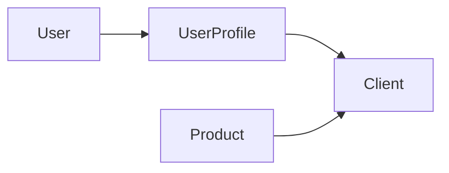

# Multi-tenant marketplace

A product marketplace where each company (client) has its own storefront, while a global catalog shows **approved** products from every store. The stack is **Django** (server-rendered templates), **PostgreSQL**, and **Docker Compose**.

The Django app, Docker stack, and seeder are in the repo. Templates use **Tailwind CSS**, **HTMX** (`hx-boost` for in-page navigation), and **Alpine.js** (mobile nav and upload preview). The original code dump is in [docs/implementation-blueprint.md](docs/implementation-blueprint.md).

## Features

- Public catalog of approved products
- Per-store catalog at `/store/<slug>/`
- Client registration (company name + user), login, logout, and dashboard
- Product upload; new items start as **PENDING**
- Django admin actions to **approve** or **reject** products
- Auto-seeded demo data: global admin, Nike store, Apple store

## Architecture

Tenancy is **shared-schema**: one PostgreSQL database and one set of tables. A row’s `client` foreign key decides which store owns it. There are no per-tenant databases or schemas.

- **Client** — a company/store (`name`, unique `slug`)
- **UserProfile** — links a Django `User` to a `Client` (null client = global admin)
- **Product** — belongs to a client; `status` is `PENDING`, `APPROVED`, or `REJECTED`



The public catalog filters `Product` by `status=APPROVED`. A store URL filters by that client as well. Dashboard and upload use `request.user.profile.client`. Superusers without a profile are treated as global admins and are not store managers.

## Expected layout

```text
portal/
├── docker-compose.yml
├── .env.example
├── README.md
├── docs/
│   └── implementation-blueprint.md
├── media/
└── backend/
    ├── Dockerfile
    ├── requirements.txt
    ├── entrypoint.sh
    ├── manage.py
    ├── core/          # Django project (settings, urls)
    ├── marketplace/   # models, views, admin, seed command
    └── templates/
```

`media/` is mounted into the web container at `/app/media`. Postgres data lives in the `postgres_data` Compose volume.

## Requirements

- Docker Compose v2 (`docker compose`)
- Host ports **8000** (Django) and **5432** (Postgres, optional for host tools)

## Environment variables

The blueprint currently hardcodes these values in Compose and Django settings. Treat them as **development defaults only**; do not use them in production.

| Variable | Purpose | Spec default |
| :--- | :--- | :--- |
| `POSTGRES_DB` | Database name | `marketplace_db` |
| `POSTGRES_USER` | Database user | `postgres_user` |
| `POSTGRES_PASSWORD` | Database password | `securepassword123` |
| `DB_HOST` | Hostname of Postgres from the web service | `db` |
| `DJANGO_SECRET_KEY` | Django secret key | `dev-insecure-secret-key` |
| `DJANGO_DEBUG` | `1` for debug mode | `1` |
| `DJANGO_ALLOWED_HOSTS` | Comma-separated hosts | `*` |

## Run

```bash
docker compose up --build
```

The `db` service must be healthy (`pg_isready`) before `web` starts. The web entrypoint waits on Postgres, runs migrations, seeds if `seed_marketplace` exists, then starts `runserver` on `0.0.0.0:8000`.

Then open:

- Storefront: [http://localhost:8000/](http://localhost:8000/)
- Admin: [http://localhost:8000/admin/](http://localhost:8000/admin/)
- Client login: [http://localhost:8000/portal/login/](http://localhost:8000/portal/login/)

Copy [.env.example](.env.example) if you want a local env file. Compose currently uses the same development defaults inline.

**Dev-only** accounts created by `seed_marketplace` (change these before any shared or production use):

| Role | URL | Username | Password |
| :--- | :--- | :--- | :--- |
| Global admin | `/admin/` | `admin` | `adminpassword123` |
| Nike manager | `/portal/login/` | `nike_manager` | `password123` |
| Apple manager | `/portal/login/` | `apple_manager` | `password123` |

## Main routes

| Path | Purpose |
| :--- | :--- |
| `/` | Global catalog (approved products) |
| `/store/<slug>/` | One client’s approved catalog |
| `/portal/register/` | Create a company account and store |
| `/portal/login/` | Client portal login |
| `/portal/logout/` | Log out |
| `/portal/dashboard/` | That client’s products (all statuses) |
| `/portal/upload/` | Submit a product for review |
| `/admin/` | Django admin (approve/reject) |

## Limitations and next steps

This is a catalog and moderation flow, not a full marketplace: there is no cart, checkout, orders, or payments.

The spec also leaves several production gaps:

- Tenant isolation is a foreign key; upload and dashboard are scoped to `request.user.profile.client`
- Seeder runs on **every** container start (idempotent)
- App server is Django `runserver`, not a production WSGI server
- Secrets and demo passwords are development defaults in Compose and `.env.example`

Logout uses POST with a CSRF token. Further spec notes are in [docs/implementation-blueprint.md](docs/implementation-blueprint.md).
